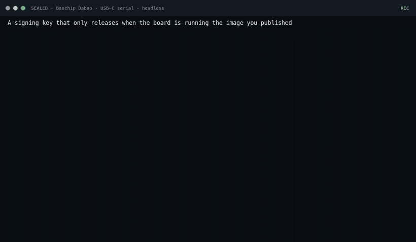
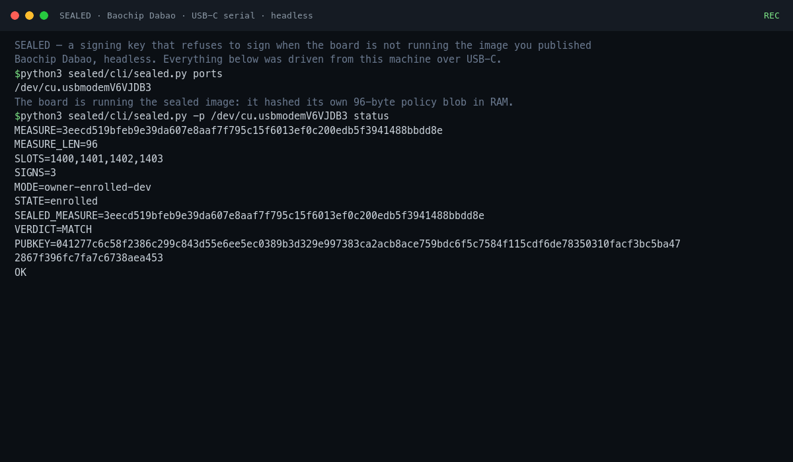
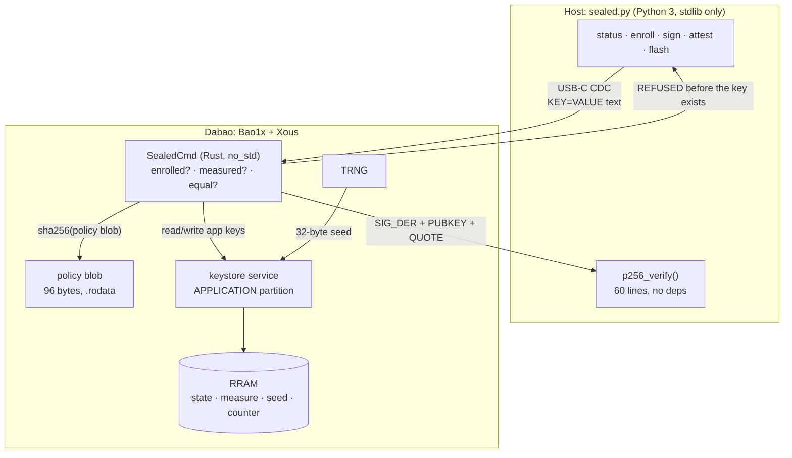

# Your signing key should refuse to work

*A hardware signer that checks what it is running before it touches the key, built on an open board that has no vendor attestation to lean on.*



Nine seconds into the demo, the board refuses.

```
$ sealed.py sign --tx tx.bin
REFUSED reason=MEASUREMENT_MISMATCH
SEALED_MEASURE=3eecd519bfeb9e39da607e8aaf7f795c15f6013ef0c200edb5f3941488bbdd8e
MEASURE=44c9cb139733065c9d92f70990fe0a64f4804da7564a9c21389703e489b1c627
ERR running image is not the image that was sealed
RESULT=REFUSED
```

Two hashes, one byte apart in the source that produced them. The device hashed its own measured window, compared it to the digest the owner sealed at enrollment, and declined to unseal the key. No server was consulted. No vendor said it was fine. The board decided the code it was running was not the code it had been told to trust, and it stopped.

That refusal is the whole project. Everything else in this post exists to make it true on a real chip.

## The gap in every hobby hardware signer

A hardware wallet is a computer that holds a key and a promise. The promise is "I will only sign what the user approved", and on a closed device the promise is enforced by a factory attestation chain: the vendor's key signs the firmware, the firmware measures itself on boot, and the host can check the whole thing.

Open boards do not have that. The chip is documented, the RTL is published, the firmware is open source, and no one is going to hand you a vendor attestation key for a part that ships in developer kits. That is not a flaw, it is what "open" costs you.

So an open-board signer has exactly two options. It can pretend to be closed, which means writing a README that says "secure" and hoping nobody looks. Or it can be honest about the trust anchor and say: you, the owner, measure the thing once, and the device refuses to sign if it ever measures differently.

SEALED is the second option.



## What the Dabao gives you

The Baochip Dabao is a RISC-V board built around Bao1x: an application core, RRAM, a hardware TRNG, a keystore with per-app key slots, an MMU, and a second "BIO" coprocessor for I/O. It runs Xous, a small microkernel with process isolation and a message-passing keystore service.

The parts that matter here:

The keystore stores key material in RRAM, inside a data partition that belongs to the app. Writes go through the kernel, which enforces an ACL. Reads come back to the app, not to the host. The partition survives a reboot and, this is the important one, survives reflashing the application image.

The TRNG gives you a real seed, so the device identity is generated on the device and never leaves it in a form the host can read.

The MMU means the app's memory is the app's memory. The policy blob the device measures lives in the app's own image, mapped by the kernel, not in a shared buffer the host can poke.

What the board does not give you is an attestation key. There is no factory certificate chain to check against, and there is not going to be one. So the anchor is the owner's enrollment, and the README says so in those words.

## The shape of it



The host asks. The board decides. The key never crosses the cable, and the seed never leaves RRAM.

## Measuring something small on purpose

The naive design hashes the whole firmware image. On a 150 MHz core that is slow, and it is fragile in a way that will bite you: release images get stripped, linker scripts reorder sections, and "hash everything between these two symbols" turns into a build-specific guess.

So SEALED measures one 96-byte static.

```
[ 0.. 8)  b"SEALBLOB"
[ 8..88)  "SEALEDv1|gate=measure-before-unseal|curve=p256|hash=sha256"  (NUL padded)
[88..96)  b"SEALGATE"
```

One blob of known length means the device and the host always agree on exactly which bytes are covered. No linker ordering, no symbol table, no section arithmetic.

```rust
const BLOB_LEN: usize = 96;
const POLICY_OFF: usize = 8;
const POLICY_LEN: usize = 80;
const BLOB_MAGIC: [u8; 8] = *b"SEALBLOB";
const BLOB_END: [u8; 8] = *b"SEALGATE";

/// The text the gate reads at runtime, so this is not decoration: patching a
/// byte here changes behaviour *and* the measured digest.
const POLICY_TEXT: &[u8] = b"SEALEDv1|gate=measure-before-unseal|curve=p256|hash=sha256";

const fn build_blob() -> [u8; BLOB_LEN] { /* magic | policy | end */ }
```

The detail that makes this more than a checksum: the gate parses that policy text at runtime. `gate=measure-before-unseal` is not a comment that gets compiled away, it is a string the code inspects to decide how to behave. Change a character and you have changed the program's instructions, not just its data. The measurement moves because the behavior moved.

Two digests, both confirmed three ways (host-side ELF hash, device `MEASURE=`, byte-identical rebuild):

```
clean     3eecd519bfeb9e39da607e8aaf7f795c15f6013ef0c200edb5f3941488bbdd8e
tampered  44c9cb139733065c9d92f70990fe0a64f4804da7564a9c21389703e489b1c627
apps.uf2  6d8dfecacea8cbac03747b29c232d8cb01e0b2a3a78b6733b4f8d5eb2c9ab4e7
```

That last line matters for reproducibility. A fresh clone, the graft script, the build, and you get the same UF2 byte for byte, so the digest in the README is checkable by anyone with the toolchain.

## The gate, and the one thing to check in review

Every command runs the same three checks: is there a seal, can I compute the current measurement, do they match. Signing is where it counts.

```rust
if !enrolled {
    writeln!(ret, "REFUSED reason=UNSEALED").ok();
    return Ok(Some(ret));
}
let (s, c) = match (&sealed, &current) {
    (Some(s), Ok(c)) => (s, c),
    _ => { writeln!(ret, "REFUSED reason=MEASUREMENT_UNAVAILABLE").ok(); return Ok(Some(ret)); }
};
if s != c {
    writeln!(ret, "REFUSED reason=MEASUREMENT_MISMATCH").ok();
    writeln!(ret, "SEALED_MEASURE={}", hex(s)).ok();
    writeln!(ret, "MEASURE={}", hex(c)).ok();
    return Ok(Some(ret));
}
let sk = SigningKey::from_bytes(seed)?;
let sig: Signature = sk.sign(&msg);
```

The refusal returns before `SigningKey::from_bytes` is ever reached. That is the property to look for in any gate like this: not "we check the condition and then branch", but "there is no path where the sensitive object exists while the condition is false". If the key object is constructed first and the check happens later, someone will add an early return in six months and the gate becomes decoration.

## State that survives the thing you are defending against

The seal lives in four keystore slots:

```rust
const SLOT_STATE:   usize = 1400;  // "SEALED01" when enrolled
const SLOT_MEASURE: usize = 1401;  // digest captured at enroll
const SLOT_SEED:    usize = 1402;  // P-256 scalar from the TRNG
const SLOT_COUNTER: usize = 1403;  // u32 LE signature count
```

These sit in the app's `APPLICATION` data partition, `DataRange(384..1920)`. Reflash `apps.uf2` and the slots are still there. That is what turns the tamper test from a build-time assertion into a security property: the attacker's new image runs on a device that still remembers what the old one measured.

It also gives you a nice side effect. The signature counter keeps counting across reflashes, so the tampered run shows `SIGNS=1`, the same counter value from before the swap. The device did not forget anything; it just refused.

## Two bugs the desk did not have

The first version of the state loader looked reasonable and was wrong.

```rust
if state[..8] == MAGIC_ENROLLED {   // 8 bytes compared against 32
```

`state` is a full 32-byte slot. `MAGIC_ENROLLED` is a 32-byte array. Slicing the left side gives you a `&[u8]` of length 8, and Rust happily implements `PartialEq` between a slice and an array, comparing element by element. Eight against thirty-two. Always false.

So `status` reported `unsealed` on a device that had enrolled, persisted its seed, and read it back successfully. My first instinct was that the keystore ACL was silently dropping writes, because `acram.rs` returns `Ok(())` on a denied write in one path. I spent a while reading slot allocation code before adding a diagnostic command that reads the raw slots and does a write/read roundtrip:

```
sealed probe
PROBE_STATE=5345414c45443031...   # "SEALED01" then zeros
WRITE_RT=OK
READ_RT=a5a5a5a5...
```

The keystore was fine. The comparison was not. Fix: compare the full slot. The probe command stayed in, because "is it the hardware or is it my logic" is the question you ask every single time persistence looks broken, and having a one-command answer saves an hour.

The second bug was in the console's line editor, not my code. It mangles repeated bytes in its echo, and once truncated a 66-character argument to 64. My attestation test sent a challenge, the device quoted a 64-character challenge, and the signature verified against the wrong input. The fix is defensive: the host recomputes the quote from the challenge *it sent* and fails the run unless the binding holds.

```
QUOTE=d392741c636c3c53e66eb8595ffe5954587c7600482d7267c4f8d02286cc30e6
HOST_VERIFY=PASS
CHALLENGE_BOUND=PASS
```

Anything that trusted the echoed command line would have shipped a bug that only appears when a challenge contains a doubled byte. Which is to say, rarely, and always in front of someone.

## Verifying without trusting anything

The point of a signature is that the other side can check it. If checking requires a 40 MB library, most people will not check.

So the host verifier is about sixty lines of integer arithmetic over the published P-256 constants:

```python
def p256_verify(pub, msg, der):
    """Verify a DER-encoded ECDSA signature over msg (hashed with SHA-256)."""
    r, s = _parse_der_sig(der)
    if not (1 <= r < P256_N and 1 <= s < P256_N):
        return False
    Q = _decode_pub(pub)
    if not _p256_on_curve(Q):
        return False
    z = int.from_bytes(hashlib.sha256(msg).digest(), "big")
    w = pow(s, -1, P256_N)
    pt = _p256_add(_p256_mul(P256_G, z * w % P256_N),
                   _p256_mul(Q, r * w % P256_N))
    return pt is not None and pt[0] % P256_N == r
```

`pow(s, -1, P256_N)` is modular inverse, `_p256_mul` is double-and-add, and the whole file has no imports beyond the standard library. `hostcheck` runs it against an OpenSSL-generated vector plus a one-byte mutation that must be rejected, so the verifier proves itself before it judges the board.

Same idea for the serial port. No `pyserial`, no driver package. `termios` and a file descriptor:

```python
a = termios.tcgetattr(fd)
a[3] &= ~(termios.ICANON | termios.ECHO)   # raw, no echo
a[4] = a[5] = termios.B115200
termios.tcsetattr(fd, termios.TCSANOW, a)
```

Two dependencies removed means two things a reader does not have to audit.

## Why the demo is a terminal recording

The board has no screen in this build. No HDMI, no LCD, no framebuffer. You talk to it over USB serial and it answers in text.

That is normally where hardware demos get faked: take a screenshot of a terminal, narrate over it. Instead the demo is a recording of the real thing. `tools/record_demo.py` reads a plan file, executes each line through a shell against the connected board, and stores stdout, stderr and timing as an asciicast v2 file. `tools/render_cast.py` turns the cast into an MP4 and GIF with ffmpeg and ImageMagick, adding title cards and pulling named stills at the right frames.

The honest part: every digest in the video came back from the board during that recording. The casts are committed, so you can replay them with `asciinema play` and diff them against the transcripts in the README. If I had broken something between the recording and the publish, the numbers would not line up.

Three parts, because the story has three beats:

1. Clean board. `status`, `sign`, `attest`, `dossier`. Measurement matches, signature verifies, quote binds.
2. One character changed in the policy. Rebuild, flash, ask again. `VERDICT=MISMATCH`, `REFUSED`.
3. Flash the published image back. Same public key, counter continues, signatures return.

Part 3 is the one that proves the mechanism. If the refusal had been a wiped keystore, the key would come back different or not at all. It comes back identical, because nothing was wiped. The board simply compared two hashes and did not like the answer.

## What I would build next

Whole-image measurement first. Hashing the policy blob is a policy check, not a binary check, and the stronger claim is worth the cycles. On this part that probably means a Merkle root over loaded pages, computed incrementally as the kernel maps them, rather than a single pass over the ELF at boot.

Then the hardware crypto. SHA-256 and P-256 both exist in silicon on this chip and the current build does neither of them there. Moving the signing path onto the accelerators would cut latency and shrink the trusted Rust surface to a few syscalls.

Then the BIO. The I/O coprocessor sees memory traffic and peripherals that the app core does not, which makes it the obvious place to put a watchdog: flag when the app core writes outside its expected window, and let the seal read that flag. That is a different project with a different threat model, and it is the one I would start next on this board.

The rest of the list, in the repo: encrypted signing requests instead of cleartext digests over CDC, multi-slot seals so a team can roll back without re-enrolling, threshold signing that splits the seed between the board and the host, and a static browser page that verifies a `sealed-signature.json` without installing anything.

## What it is, honestly

It is not vendor attestation. Nobody signed a certificate for this chip, and no amount of code changes that. What it is: a device that remembers what you told it to run, recomputes it every time you ask for a signature, and refuses when the answer changes. Owner-enrolled, self-measured, and reproducible from source on a board you can buy.

The code is at [github.com/harishkotra/sealed](https://github.com/harishkotra/sealed). Board module, host CLI, threat model, runbook, demo tooling, and the recorded sessions are all in the repo.

---

Built by [Harish Kotra](https://harishkotra.me) for the Baochip / Dabao hackathon at Devcon 8, Mumbai. Check out my other builds at [dailybuild.xyz](https://dailybuild.xyz).
