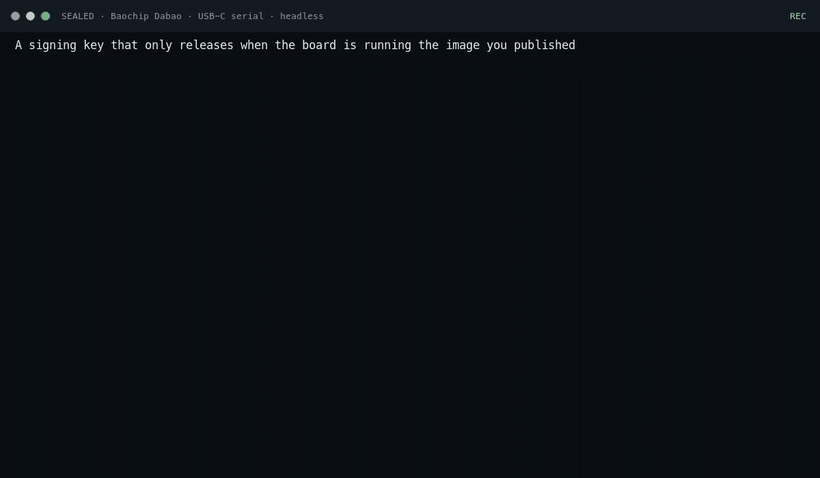
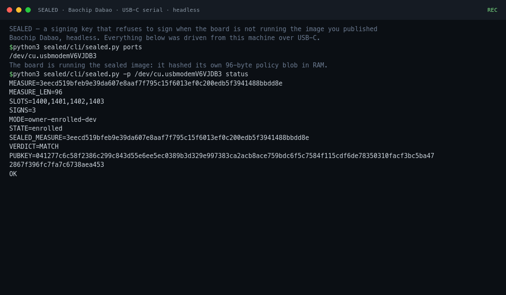
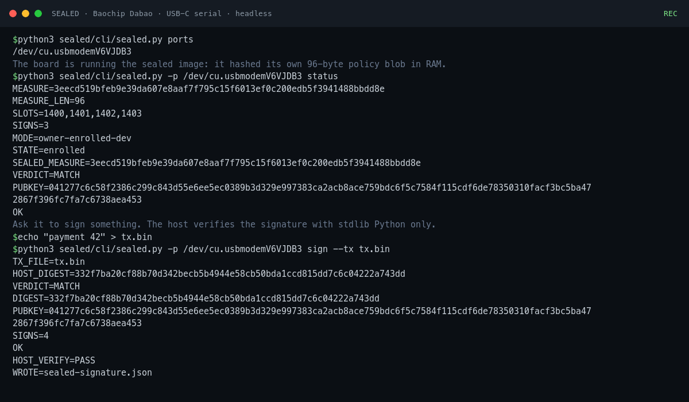
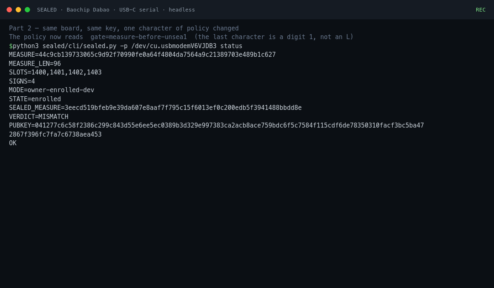
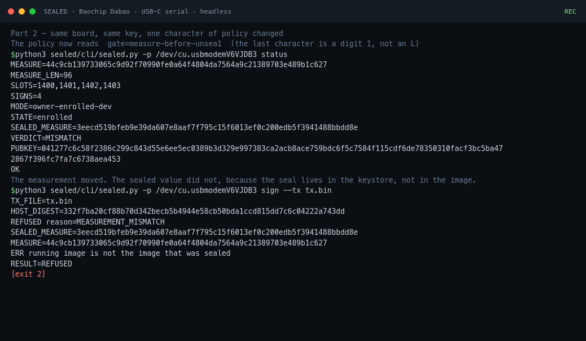
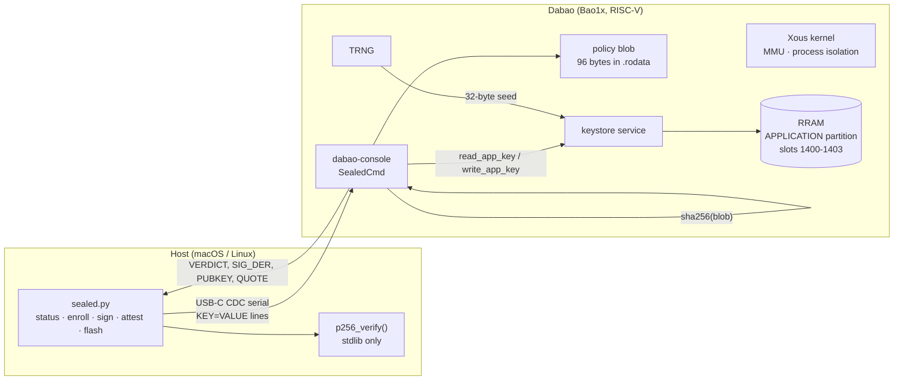
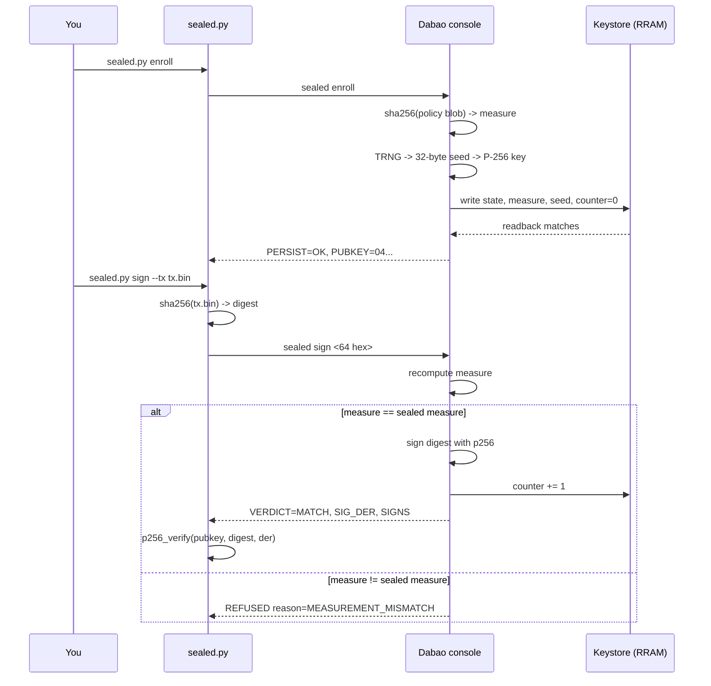

# SEALED

**A signing key that refuses to sign when the device it lives on isn't running the image you published.**

Built for the Baochip / Dabao hackathon (Devcon 8). Runs on the board, headless, driven entirely from a Mac over USB serial.

```
$ sealed.py -p /dev/cu.usbmodemV6VJDB3 status
MEASURE=3eecd519bfeb9e39da607e8aaf7f795c15f6013ef0c200edb5f3941488bbdd8e
MEASURE_LEN=96
SLOTS=1400,1401,1402,1403
SIGNS=2
MODE=owner-enrolled-dev
STATE=enrolled
SEALED_MEASURE=3eecd519bfeb9e39da607e8aaf7f795c15f6013ef0c200edb5f3941488bbdd8e
VERDICT=MATCH
PUBKEY=041277c6c58f2386c299c843d55e6ee5ec0389b3d329e997383ca2acb8ace759...
OK

$ sealed.py -p /dev/cu.usbmodemV6VJDB3 sign --tx tx.bin
TX_FILE=tx.bin
HOST_DIGEST=332f7ba20cf88b70d342becb5b4944e58cb50bda1ccd815dd7c6c04222a743dd
VERDICT=MATCH
DIGEST=332f7ba20cf88b70d342becb5b4944e58cb50bda1ccd815dd7c6c04222a743dd
SIGNS=3
OK
HOST_VERIFY=PASS

# ... now change one byte of the release policy, rebuild, flash apps.uf2 ...

$ sealed.py status
MEASURE=44c9cb139733065c9d92f70990fe0a64f4804da7564a9c21389703e489b1c627
STATE=enrolled
SEALED_MEASURE=3eecd519bfeb9e39da607e8aaf7f795c15f6013ef0c200edb5f3941488bbdd8e
VERDICT=MISMATCH

$ sealed.py sign --tx tx.bin
REFUSED reason=MEASUREMENT_MISMATCH
SEALED_MEASURE=3eecd519...
MEASURE=44c9cb13...
ERR running image is not the image that was sealed
RESULT=REFUSED
```

That last transcript is the project. The device did not ask a server, a vendor, or the host whether it was trustworthy. It hashed its own measured window, found that it no longer matched what the owner sealed, and declined to unseal the key.

## Watch it



`media/demo.mp4` is the same 36 seconds at full size. Both are rendered from `media/demo-part{1,2,3}.cast`, asciicast files recorded by `tools/record_demo.py`, which runs the real commands against the real board and stores what came back. Nothing in the video is typed from a script by hand: `demo/build_demo.sh` regenerates every artifact from a board, and the casts in this repo are the ones that produced the published video.

| | |
|---|---|
|  |  |
| `status` — the board hashed its own policy blob and agrees with the seal | `sign` — DER signature, verified by 60 lines of stdlib Python on the host |
|  |  |
| one character changed: `MEASURE` moved, `SEALED_MEASURE` did not | the key is not released — `REFUSED reason=MEASUREMENT_MISMATCH` |

Three parts: a clean session, the one-byte tamper, then the published image flashed back. Part 3 matters as much as part 2. The same public key returns and the signature counter continues from where the tampered build left off, so the refusal was a statement about the seal, not a wiped device.

## Why this, on this chip

A hardware signer's weak point is that it signs what the software on it asks it to sign. Closed vendors fix that with a factory attestation key. **Dabao has no third-party attestation key and never will** — so SEALED takes the only honest route available on an open chip: the owner enrolls a measurement on first boot, and every signature is gated on the device still measuring the same thing.

There is no vendor to trust here, and that is the point. The chip is open source, the app is open source, the measurement is reproducible on your machine, and the verification code on the host is 60 lines of dependency-free Python.

What it does protect against: a modified app image asking for a signature, a swapped `apps.uf2` on the same board, and replay of an old attestation (the challenge is fresh).

What it does not protect against: an attacker who has the cable and can re-enroll the seal to their own image, side channels on the P-256 implementation, and anything that runs on the host. `DESIGN.md` carries the full threat model instead of hand-waving at it.

## How it works



Two processes, one line protocol over the app's CDC port. The host never gets the seed. The board never signs a nonce it did not generate itself.



## What is measured

The measurement covers one 96-byte blob, hashed with SHA-256:

```
[ 0.. 8)  b"SEALBLOB"
[ 8..88)  "SEALEDv1|gate=measure-before-unseal|curve=p256|hash=sha256"  (NUL padded)
[88..96)  b"SEALGATE"
```

A single fixed-size static, not a range of linker sections. Linker ordering and stripped release images make "hash this region" fragile; one blob of known length means device and host always agree on exactly which bytes are covered.

```rust
// board/sealed.rs
const BLOB_LEN: usize = 96;
const POLICY_OFF: usize = 8;
const POLICY_LEN: usize = 80;
const BLOB_MAGIC: [u8; 8] = *b"SEALBLOB";
const BLOB_END: [u8; 8] = *b"SEALGATE";

/// The text the gate reads at runtime, so this is not decoration: patching a
/// byte here changes behaviour *and* the measured digest.
const POLICY_TEXT: &[u8] = b"SEALEDv1|gate=measure-before-unseal|curve=p256|hash=sha256";

const fn build_blob() -> [u8; BLOB_LEN] { /* magic | policy | end */ }
```

The gate parses that text at runtime, which is why patching one character changes behavior and not just a constant. The device hashes the blob in RAM; the host hashes the same 96 bytes in the ELF, and `expect --elf` asserts the magic appears exactly once so a duplicated blob is a hard error.

Reproducibility, measured on two independent checkouts of the same source:

```
# clean policy
EXPECTED_MEASURE=3eecd519bfeb9e39da607e8aaf7f795c15f6013ef0c200edb5f3941488bbdd8e
# after flipping one byte ("unseal" -> "unsea1") in the policy:
EXPECTED_MEASURE=44c9cb139733065c9d92f70990fe0a64f4804da7564a9c21389703e489b1c627
# clean rebuild is byte-identical
apps.uf2 sha256 6d8dfecacea8cbac03747b29c232d8cb01e0b2a3a78b6733b4f8d5eb2c9ab4e7
```

Both numbers were confirmed three ways: computed from the ELF on the host, reported by the device as `MEASURE=`, and reproduced byte-for-byte on a clean rebuild.

## The gate

Every command goes through the same three checks: enrolled, measurement available, measurement equal. Signing is the interesting one, because that is where the key is.

```rust
// board/sealed.rs, SealedCmd::sign
if !enrolled {
    writeln!(ret, "REFUSED reason=UNSEALED").ok();
    return Ok(Some(ret));
}
let (s, c) = match (&sealed, &current) {
    (Some(s), Ok(c)) => (s, c),
    _ => { writeln!(ret, "REFUSED reason=MEASUREMENT_UNAVAILABLE").ok(); return Ok(Some(ret)); }
};
if s != c {
    writeln!(ret, "REFUSED reason=MEASUREMENT_MISMATCH").ok();
    writeln!(ret, "SEALED_MEASURE={}", hex(s)).ok();
    writeln!(ret, "MEASURE={}", hex(c)).ok();
    return Ok(Some(ret));
}
let sk = SigningKey::from_bytes(seed)?;
let sig: Signature = sk.sign(&msg);
```

The refusal path returns before the key is ever constructed. There is no branch where a mismatched measurement reaches `SigningKey::from_bytes`, which is the first thing a reviewer should check.

## Keystore state

Four slots live in the `APPLICATION` data partition (`DataRange(384..1920)`), so they survive a reboot and an `apps.uf2` reflash:

```rust
const SLOT_STATE:   usize = 1400;  // "SEALED01" when enrolled
const SLOT_MEASURE: usize = 1401;  // digest captured at enroll
const SLOT_SEED:    usize = 1402;  // P-256 scalar from the TRNG
const SLOT_COUNTER: usize = 1403;  // u32 LE signature count
const MAGIC_ENROLLED: [u8; 32] = pad32(b"SEALED01");

fn load_state(&self) -> (bool, Option<[u8; 32]>, Option<[u8; 32]>, u32) {
    let state = self.ks.read_app_key(SLOT_STATE).unwrap_or([0u8; 32]);
    // `state` is a full 32-byte slot; compare against the whole padded magic.
    // (`state[..8] == MAGIC_ENROLLED` silently compares 8 bytes against 32 and
    // is therefore always false.)
    if state == MAGIC_ENROLLED {
        (true, self.ks.read_app_key(SLOT_MEASURE).ok(),
               self.ks.read_app_key(SLOT_SEED).ok(), counter)
    } else {
        (false, None, None, counter)
    }
}
```

That comment exists because the first version got it wrong on hardware. See [What the silicon taught us](#what-the-silicon-taught-us).

## Verifying on the host

The point of a signature is that someone else can check it. `p256_verify` is plain integer arithmetic over published curve constants, so there is no crypto dependency to trust:

```python
def p256_verify(pub, msg, der):
    """Verify a DER-encoded ECDSA signature over msg (hashed with SHA-256)."""
    r, s = _parse_der_sig(der)
    if not (1 <= r < P256_N and 1 <= s < P256_N):
        return False
    Q = _decode_pub(pub)
    if not _p256_on_curve(Q):
        return False
    z = int.from_bytes(hashlib.sha256(msg).digest(), "big")
    w = pow(s, -1, P256_N)
    pt = _p256_add(_p256_mul(P256_G, z * w % P256_N),
                   _p256_mul(Q, r * w % P256_N))
    return pt is not None and pt[0] % P256_N == r
```

`sealed.py hostcheck` runs it against an OpenSSL-generated vector plus a one-byte mutation that must be rejected, so you can validate the verifier before trusting anything it says about the board.

The attestation quote is `SHA-256(measurement ‖ challenge)`, signed by the same key. The host recomputes it from the challenge it sent and refuses to report success unless both the signature and the binding hold:

```
QUOTE=d392741c636c3c53e66eb8595ffe5954587c7600482d7267c4f8d02286cc30e6
HOST_VERIFY=PASS
CHALLENGE_BOUND=PASS
```

## Silicon used

| Block | How SEALED uses it |
|---|---|
| **Keystore (RRAM-backed)** | Device seed, sealed digest, enrollment state and signature counter live in the `APPLICATION` data partition (`DataRange(384..1920)`), so the seal survives reboot *and* `apps.uf2` reflash |
| **TRNG** | P-256 scalar for the device identity, drawn from the hardware entropy source |
| **VexRiscv + MMU** | The measured window is app memory mapped by the Xous kernel; the signing key never appears in any host-visible buffer |
| **RRAM** | Persistence of the seal across reflash — the property that makes the tamper demo real rather than a build-time check |
| **Xous microkernel** | Process isolation, keystore service, serial console; SEALED is a console command inside the stock `dabao-console` app |
| **Crypto accelerators** | *Not used, deliberately.* Hashing and ECDSA run in Rust (`sha2`, `p256`) for auditability; the hardware paths are the obvious next step and are called out in `DESIGN.md` |
| **BIO / I/O coprocessor** | *Not used.* SEALED is a trust-layer project; the BIO is the right place to look for the next attack story (see `DESIGN.md` §8) |
| **IRIS / RTL** | Source-level claim: the whole measurement story is checkable against published RTL and the published app source |

The honest summary: keystore, TRNG, MMU, RRAM and the kernel are genuinely load-bearing. The crypto accelerators and the BIO are not, and the write-up says so.

## Software stack

| Layer | What |
|---|---|
| SoC | Baochip Bao1x (Dabao board): VexRiscv core, RRAM, TRNG, keystore, MMU |
| Kernel | Xous microkernel — process isolation, keystore service, serial console |
| App | `dabao-console` (Rust, `no_std`); SEALED is one console command inside the stock shell |
| Device crypto | `p256` + `sha2` (RustCrypto), built for `riscv32imac-unknown-xous-elf` |
| Host CLI | Python 3, stdlib only: `termios`, `hashlib`, `struct`, `base64`, hand-rolled P-256 |
| Flash path | boot1 REPL `uf2 <base64>` over USB-C CDC serial, sent by the CLI |
| Evidence | asciicast v2 recordings rendered to MP4/GIF/PNG with ffmpeg + ImageMagick |
| Toolchain | Rust 1.99.1 (Baochip fork) + `xtask install-toolkit` |

## Quick start

```sh
# 1. build (Xous target comes from the Baochip Rust fork)
cargo +1.99.1 xtask install-toolkit --force --no-verify
cd xous-core && CI=true cargo +1.99.1 xtask dabao dabao-console --no-verify

# 2. verify the measured window matches the published digest
python3 sealed/cli/sealed.py expect --elf \
  target/riscv32imac-unknown-xous-elf/release/dabao-console

# 3. flash over serial (macOS blocks the BAOCHIP volume from non-interactive
#    processes, so the CLI speaks boot1's `uf2 <base64>` console command instead)
python3 sealed/cli/sealed.py -p /dev/cu.usbmodem<BOOT1> flash \
  --uf2 target/riscv32imac-unknown-xous-elf/release/loader.uf2
#    repeat for xous.uf2 then apps.uf2, then:
python3 sealed/cli/sealed.py -p /dev/cu.usbmodem<BOOT1> send boot
#    talk to it on the *new* port (it re-enumerates on handoff):
python3 sealed/cli/sealed.py selftest
python3 sealed/cli/sealed.py enroll
python3 sealed/cli/sealed.py sign --tx tx.bin
```

No screen needed. The board has no display in this build; everything is text over serial and the host does the talking.

Full board procedure, including the tamper drill and a troubleshooting table: **[RUNBOOK.md](RUNBOOK.md)**. Ninety-second recording script: **[DEMO.md](DEMO.md)**. Threat model and the list of things this does *not* protect against: **[DESIGN.md](DESIGN.md)**. Build narrative: **[WRITEUP.md](WRITEUP.md)**, and the long-form developer write-up: **[BLOG.md](BLOG.md)**.

## Host CLI

`sealed/cli/sealed.py` — Python 3, standard library only. No `pip install`, no serial driver package, no crypto library: it opens the serial device with `termios` directly and verifies ECDSA P-256 in pure Python. `sealed.py hostcheck` checks that verifier against an openssl-generated vector before you trust it.

| Command | Purpose |
|---|---|
| `ports` | list USB serial devices |
| `monitor --seconds N` | dump the raw serial transcript (boot logs, bootloader console) |
| `send <line>` | send one raw line, print everything back |
| `flash --uf2 f` | write an image over boot1's serial `uf2` command (`--dry-run` parses blocks) |
| `selftest` | on-device SHA-256 KAT, ECDSA roundtrip, TRNG check |
| `status` | measurement, state, verdict, signature counter |
| `enroll` | seal the current measurement to a fresh TRNG key |
| `sign --tx f` / `--digest h` | gate-and-sign; writes `sealed-signature.json` |
| `attest [--challenge]` | freshness quote over `SHA-256(measurement ‖ challenge)` |
| `policy` | print the measured blob and its magic check |
| `expect --elf f` | compute the expected measurement from a build artifact |
| `dossier [elf] [out.md]` | one-page evidence bundle (device quote vs source rebuild) |
| `forget` | clear the seal (owner re-anchors) |
| `send "sealed probe"` | device-side keystore diagnostics (slot reads + write/read roundtrip) |
| `hostcheck` | validate the host-side P-256 verifier |

## Repository layout

```
sealed/
  board/sealed.rs        the SealedCmd console command, measured blob, gate, keystore state
  cli/sealed.py          host CLI, stdlib only (serial, flash, sign, attest, dossier, P-256)
  scripts/apply.py       idempotent graft onto a stock xous-core checkout (and --revert)
  demo/                  *.plan scripts + build_demo.sh (record -> cast -> mp4/gif/stills)
  tools/                 record_demo.py (asciicast v2), render_cast.py (cast -> mp4/gif)
  media/                 recorded casts, demo.mp4, demo.gif, five stills
  DESIGN.md              threat model, what is and is not measured
  RUNBOOK.md             board bring-up and the tamper drill, step by step
  DEMO.md                90-second recording script with exact commands
  WRITEUP.md             build narrative, including the hardware bugs
  BLOG.md                technical blog post for developers
```

`scripts/apply.py --xous <checkout>` touches exactly three files: it copies `board/sealed.rs` to `apps-dabao/dabao-console/src/cmds/`, wires the module into `cmds.rs`, and adds `p256` + `sha2` to the app's `Cargo.toml`. Running it twice is a no-op; `--revert` removes it.

## Verified on hardware

Every number below is from a Dabao running the sealed image, driven over USB-C from a Mac, captured at 2026-11-09.

```
sealed selftest    SHA256_ABC=ba7816bf...  SHA256_KAT=PASS  ECDSA_ROUNDTRIP=PASS
                   ECDSA_BADMSG=PASS  TRNG=OK
sealed enroll      PERSIST=OK  ENROLLED=1
                   PUBKEY=041277c6c58f2386c299c843d55e6ee5ec0389b3d329e997383ca2acb8ace759...
sealed status      MEASURE=3eecd519...dd8e  STATE=enrolled  VERDICT=MATCH  SIGNS=1
sealed sign f17f.. VERDICT=MATCH  SIG_DER=3045022100bd933bbb...  SIGNS=1
sealed attest 7ea3 QUOTE=d392741c...30e6
sealed probe       PROBE_STATE=5345414c45443031...  WRITE_RT=OK  READ_RT=a5a5...
```

Host side, from those exact transcripts: `HOST_VERIFY=True` for the signature, `False` when one byte of the message is flipped, and the quote recomputed as `sha256(measurement ‖ challenge)` matches the device byte-for-byte.

Tamper drill on the same board: flash an image whose policy differs by one byte, reboot, ask for a signature.

```
MEASURE=44c9cb139733065c9d92f70990fe0a64f4804da7564a9c21389703e489b1c627
SEALED_MEASURE=3eecd519bfeb9e39da607e8aaf7f795c15f6013ef0c200edb5f3941488bbdd8e
VERDICT=MISMATCH
REFUSED reason=MEASUREMENT_MISMATCH
```

`SIGNS=1` in the tampered run is the same counter from before the reflash: the keystore state survives `apps.uf2` replacement, which is what makes the refusal a statement about the seal rather than about a rebuild. Flash the published image back and `VERDICT=MATCH` returns with the same `PUBKEY` and `SIGNS=2`.

## What the silicon taught us

Two bugs that no host-side test would have found.

`state[..8] == MAGIC_ENROLLED` compares an 8-byte slice against a 32-byte array. Rust accepts it (slice versus array implements `PartialEq`), the comparison is always false, and `status` reported `unsealed` on a device that was enrolled with a seed that had definitely persisted. Ten minutes inside `acram.rs` made a silent keystore ACL write-drop look like the culprit. The `probe` command settled it: writes and reads were fine, the comparison was not. Fix: compare the full slot. `probe` stayed in the CLI, because "is it the keystore or is it my logic" is the question you ask every time persistence misbehaves.

The console's serial line editor mangles repeated bytes in its *echo*, and once truncated a 66-character argument to 64. The device's own output lines are authoritative, so the CLI now re-derives the quote from the challenge it sent and fails unless `CHALLENGE_BOUND=PASS`. Code that trusted the echoed command line would have shipped a bug that appears only when a challenge happens to contain a doubled byte.

## Honest limits

* No factory attestation key exists on this part, so the trust anchor is your own enrollment. This is owner-enrolled, self-measured. It is not vendor-attested, and this README will not pretend otherwise.
* The measurement covers the policy blob, not the whole image. Hashing an entire ELF on a 150 MHz core is on the roadmap, not in the code.
* The signing path is Rust `p256`, not the accelerators. Constant-time behavior is whatever RustCrypto provides.
* Loading a dev-signed image flips boot1's next-stage key identity to `3/3 (dev)` in `audit`. Visible, reversible by flashing a stock beta-signed image, disclosed here rather than buried.

## Status

* Board module builds clean with the Baochip toolchain (1.99.1 + `xtask install-toolkit`).
* Fresh clone → `apply.py` → build produces all three UF2s; the measurement matches the published digest on both checkouts, and a clean rebuild is byte-identical.
* Host CLI self-checks pass without any hardware attached (`hostcheck`).
* **Run on physical silicon**: measurement parity, enroll/persist, sign, attest and the tamper refusal are all verified on a Dabao (transcripts above).

## Fork it and build on it

The whole thing is meant to be forked. The board is open, the kernel is open, and nothing here depends on a service I run.

```sh
git clone https://github.com/harishkotra/sealed
cd sealed
python3 cli/sealed.py hostcheck          # verifier passes with no hardware attached
python3 cli/sealed.py expect --elf <your dabao-console binary>

# with a Dabao on the desk
python3 scripts/apply.py --xous ~/code/xous-core
cd ~/code/xous-core && CI=true cargo +1.99.1 xtask dabao dabao-console --no-verify
```

Development loop that costs the fewest replugs: build, run `expect --elf` (host only), then flash the three UF2s in one pass, boot, and run every console command you need before unplugging. Each reset needs a cable cycle, so batch your work.

Good first issues, roughly by size:

* `verify --json file` on the host, so CI can check a signature bundle without a board.
* Unit tests for `uf2_blocks()` and `_parse_der_sig()` using bytes captured in this repo.
* `status --json`, because scraping `KEY=VALUE` lines is fine until it is not.
* `--port auto` that tells boot1 from the app CDC port by probing `sealed status` first.

PR checklist I actually use: `expect --elf` matches the digest in this README, or the README changes in the same commit; `hostcheck` and `selftest` pass; new device output is one `KEY=VALUE` per line; anything that touches the policy blob ships both digests. New command means a new row in the CLI table and a line in `DEMO.md`.

## Roadmap

In the order I would build them:

1. **Whole-image measurement.** Hash the loaded app image, or a Merkle root over its pages, instead of a 96-byte policy blob. The claim becomes "the board is running this binary", which is stronger and harder to fake.
2. **Use the hardware crypto.** The accelerators exist and are unused. Moving SHA-256 and P-256 onto them cuts signing latency and shrinks the trusted Rust surface.
3. **A BIO-side watchdog.** The I/O coprocessor sees memory and peripherals the app core does not. A watcher that flags writes outside the expected window is the natural next project on this part.
4. **Encrypted signing requests.** Today the digest arrives in cleartext over CDC, which is fine on a desk and wrong over an untrusted cable.
5. **Multi-slot seals.** Keep stable and canary images sealed at once and choose at boot, so a team can roll back without re-enrolling.
6. **Threshold mode.** Split the seed between the keystore and a host share; the board alone cannot sign, and neither can the host alone.
7. **A browser verifier.** The P-256 verifier is 60 lines of Python. Port it to a static page and anyone can check a `sealed-signature.json` without installing anything.

Open an issue before starting one of these so we do not collide.

## Credits

Standing on: [Xous](https://github.com/betrusted-io/xous-core) by Bunnie Huang and the Betrusted contributors, [RustCrypto](https://github.com/RustCrypto) for `p256` and `sha2`, and Baochip for shipping an open board with a keystore on it.

Check out my other builds at [dailybuild.xyz](https://dailybuild.xyz).
